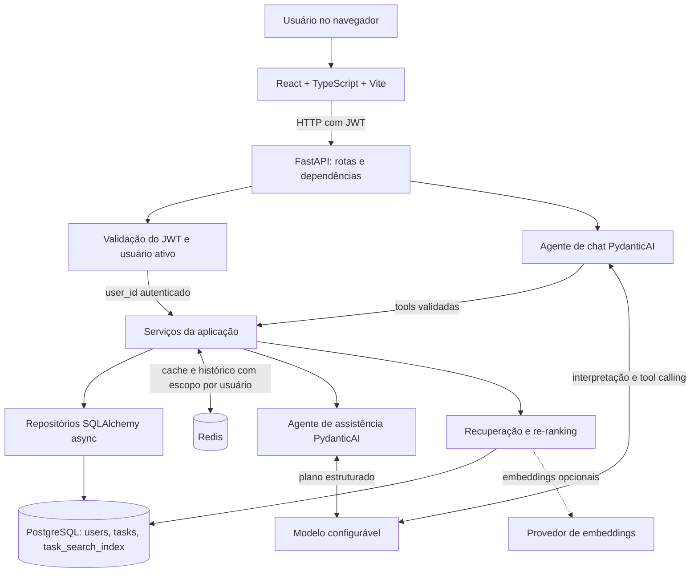
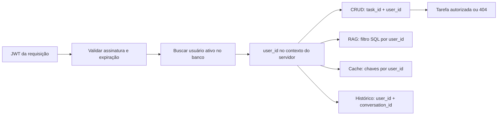
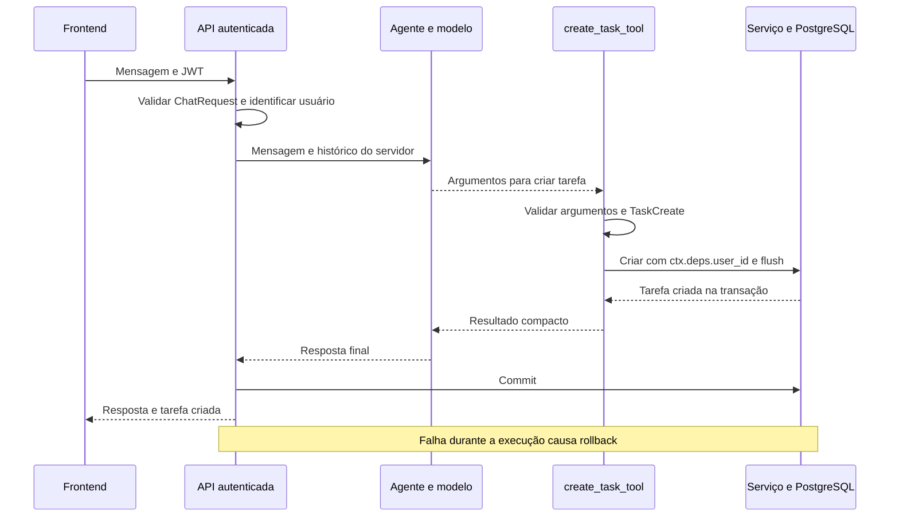
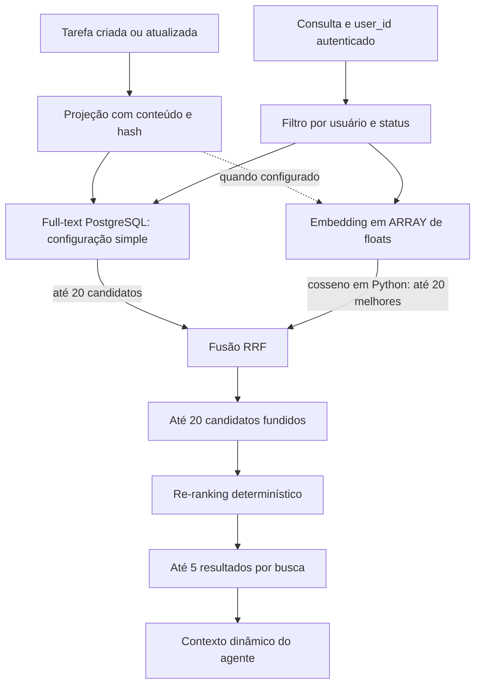

# Arquitetura e decisões do projeto

Documento baseado na implementação verificada em 27/11/2026. Explica o que
existe, por que foi escolhido e quais limites ainda temos. O [README](../README.md)
contém o enunciado e os comandos; o [TASKS](../TASKS.md) registra a evolução.

## 1. Visão geral

O produto é um gerenciador de tarefas com dois usos de IA: criar tarefas por
linguagem natural e analisar uma tarefa existente para sugerir um plano.
O backend decide quem pode acessar cada dado e executa as gravações. O modelo
interpreta pedidos e produz sugestões, sempre sujeito aos contratos do código.

As setas representam dependências e comunicação. O agente não acessa o banco
diretamente: as tools usam os serviços com o usuário fornecido pelo backend.

## 2. Monólito em camadas

**Decisão:** manter uma única aplicação backend, separada em rotas, serviços,
repositórios, schemas e agentes.

| Componente | Responsabilidade | Código |
|---|---|---|
| Rotas | Contrato HTTP, autenticação e resposta | [endpoints](../app/api/v1/endpoints/) |
| Dependências | Sessão do banco e identidade autenticada | [deps.py](../app/api/deps.py) |
| Serviços | Casos de uso e regras compartilhadas | [services](../app/services/) |
| Repositórios | Consultas e alterações no banco | [repositories](../app/repositories/) |
| Schemas Pydantic | Validar entrada, saída e argumentos da IA | [schemas](../app/schemas/) |
| Models SQLAlchemy | Estrutura persistida e relacionamentos | [models](../app/models/) |
| Agentes | Prompts, tools e saída estruturada | [agent](../app/agent/) |

**Motivo:** API e tools reutilizam `task_service`, evitando regras diferentes
para criação manual e criação pelo chat. Um monólito é suficiente para o tamanho
do desafio e facilita executar, testar e entender o fluxo.

**Limite:** algumas decisões de transporte ainda aparecem nas rotas, como o
registro de usuários e a administração. Não criamos uma camada extra para cada
operação simples. Microserviços exigiriam coordenação e operação sem benefício
comprovado neste volume.

## 3. Isolamento por usuário: nosso tenant

**Decisão:** banco e tabelas compartilhados, com `user_id` como fronteira de
isolamento. Cada usuário possui suas tarefas. Não existem organizações, equipes
ou compartilhamento entre membros de uma empresa.

O backend valida o JWT, transforma o `sub` em UUID, consulta o usuário e exige
que ele esteja ativo. O resultado alimenta `AgentDeps.user_id` e os serviços.
O proprietário nunca é decidido pelos argumentos da LLM.

**Motivo:** uma mensagem como “use o ID de outra pessoa” não deve alterar o
escopo da tool. As consultas filtram pelo proprietário; tarefa inexistente e
tarefa alheia retornam o mesmo `404`.

**Administração:** `is_admin` é verificado no banco para permitir listar contas
e ativar/desativar usuários comuns. A conta administrativa é criada por
[CLI explícita](../seed/create_admin.py). O cadastro público não concede esse
privilégio, e o painel não expõe tarefas alheias. Conta desativada é recusada
nas requisições seguintes, inclusive com um JWT anteriormente emitido.

**Limites:** não há Row-Level Security no PostgreSQL; a proteção depende das
consultas da aplicação. O [backfill do índice](../app/services/task_retrieval.py)
é uma rotina operacional que percorre tarefas de todos os usuários e não é uma
tool pública. Os endpoints administrativos também são exceções explícitas à
listagem restrita à própria conta.

Evidências: [isolamento](../tests/test_isolation.py),
[administração](../tests/test_admin.py) e
[repositório de tarefas](../app/repositories/task_repository.py).

## 4. Dois agentes com responsabilidades distintas

### Chat: interpretar e solicitar ações

O [agente de chat](../app/agent/agent.py) dispõe de três tools:

- `create_task_tool`: valida um `TaskCreate` e chama o serviço de criação.
- `list_tasks`: consulta até dez tarefas do usuário.
- `search_task_memory`: recupera até cinco tarefas relevantes do usuário.

As tools são sequenciais porque compartilham uma `AsyncSession`, que não deve
executar consultas concorrentes. A execução do chat tem limite de cinco
requisições ao modelo e três chamadas bem-sucedidas de tools.

O `flush` envia alterações dentro da transação; o `commit` as confirma.
Os repositórios não fazem commit por conta própria. Assim, uma falha no run
pode desfazer as criações antes de responder com erro controlado.

O chat oferece JSON e streaming SSE. No streaming, textos podem chegar antes
do commit; o evento final `done` confirma o resultado. Uma falha posterior ao
início da transmissão é sinalizada por evento de erro, não por uma troca do
status HTTP já enviado.

### Assistente: analisar sem executar mudanças

O [segundo agente](../app/agent/task_assistant.py) não possui tools de escrita.
Recebe uma tarefa já autorizada e retorna `TaskAssistance`: resumo,
complexidade, horas estimadas, prioridade sugerida, justificativa, passos,
riscos e perguntas.

**Motivo:** o usuário pede um plano, não uma alteração automática de prioridade
ou status. Separar os agentes reduz as permissões disponíveis em cada fluxo.

O prompt fixo define o comportamento. As instruções dinâmicas, com
`RunContext[AssistantDeps]`, fornecem a tarefa e o contexto recuperado.
Dados pessoais de autenticação e tarefas de terceiros ficam de fora.

Quando a descrição está ausente ou só contém espaços, um `output_validator`
rejeita respostas sem perguntas e solicita nova tentativa com `ModelRetry`.
Se o agente não produzir uma saída aceitável, a API retorna `503`.

**Limite:** validar formato e presença de perguntas não comprova que um plano
é verdadeiro ou útil. A qualidade semântica exige avaliação com uma LLM real.

## 5. RAG e memória derivados exclusivamente das tarefas

RAG significa buscar contexto relevante antes da geração. O corpus é formado
por título, descrição, departamento, prioridade e status das próprias tarefas.
Chat, respostas da IA e documentos externos não entram nesse índice.

**Decisão:** `tasks` é a fonte da verdade; `task_search_index` é uma projeção
reconstruível. Um hash do conteúdo e o identificador do modelo evitam embeddings
desnecessários. Exclusões removem o índice por cascade. A recuperação confere
o `user_id` tanto da tarefa quanto da projeção.

**RRF** combina as posições dos resultados, em vez de somar scores de escalas
diferentes. O re-ranking usa o score RRF normalizado e sinais de departamento,
recência e prioridade. Não é um cross-encoder nem uma segunda LLM.

No assistente, são feitas duas buscas: até cinco abertas e até cinco concluídas,
excluindo a tarefa atual. As abertas contextualizam o trabalho em andamento;
as concluídas oferecem referências semelhantes. Ter concluído uma tarefa não
significa que o sistema conheça seu resultado real ou o esforço efetivamente
gasto: esses campos não existem no domínio atual.

**Limites deliberados:**

- Sem `EMBEDDING_MODEL`, a busca usa apenas o canal lexical.
- Vetores são armazenados em `ARRAY(Float)`, sem pgvector; o cálculo em Python
  carrega os vetores elegíveis do usuário e não escala para grandes corpora.
- O re-ranking pode alterar a ordem conforme metadados; ganho de qualidade não
  está comprovado pela avaliação atual.
- Prazo (`due_date`) não compõe o índice nem o contexto atual do assistente.
- Memória aqui é recuperação de dados existentes, não treinamento do modelo.

Evidências: [retrieval](../app/services/task_retrieval.py),
[testes](../tests/test_task_retrieval.py) e
[avaliação de recuperação](retrieval-eval.md).

## 6. Redis: cache e histórico curto

**Decisão:** Redis acelera consultas e mantém continuidade da conversa; os dados
duráveis de usuários e tarefas ficam no PostgreSQL.

| Uso | Identidade da chave | Comportamento |
|---|---|---|
| Lista | `tasks:list:{user_id}:{version}:{filters_hash}` | Cache por filtros e versão do usuário |
| Assistência | `assist:v2:{user_id}:{task_id}:{updated_at}:{version}` | Invalida também quando outras tarefas do usuário mudam |
| Histórico | `chat:{user_id}:{conversation_id}` | TTL e corte nas mensagens recentes |

As mutações avançam a versão de tarefas; as rotas invalidam novamente após o
commit para reduzir a janela de uma leitura concorrente cachear dados antigos.
As chaves antigas expiram por TTL, com pequena variação para distribuir a carga.

O histórico vem do servidor, não de mensagens arbitrárias enviadas pelo
frontend. O corte preserva o início de um turno, evitando separar uma chamada
de tool do seu resultado. São mantidas até 20 mensagens por configuração padrão,
com TTL base de 24 horas. Não há resumo nem limite por tokens atualmente.

**Trade-off:** a conversa pode desaparecer após expiração, reinício ou perda do
Redis. Falhas de acesso ao Redis são registradas e tratadas como cache miss ou
histórico vazio. O Compose exige Redis saudável para iniciar a API; a tolerância
descrita é principalmente o comportamento da aplicação durante a execução.

## 7. Validação, privacidade e recuperação de falhas

**Pydantic nas fronteiras:** valida a requisição HTTP, os argumentos das tools,
o `TaskCreate` e o resultado estruturado do assistente. O schema garante tipos,
enums e restrições, não a veracidade do conteúdo.

**Prompt injection:** texto de tarefas é conteúdo não confiável. No assistente,
blocos delimitados e neutralização dos marcadores dificultam forjar a estrutura
do contexto. As instruções dizem para tratar esses blocos como dados. A garantia
de proprietário, porém, vem do filtro no código; um prompt não substitui autorização.

| Falha | Resposta implementada |
|---|---|
| Token inválido, usuário ausente ou inativo | `401` |
| Usuário comum em endpoint administrativo | `403` |
| Tarefa ausente ou alheia | `404` |
| Payload HTTP inválido | `422` |
| Falha do modelo ou saída inválida após tentativas | `503` no fluxo JSON |
| Redis indisponível | Consulta sem cache ou conversa sem histórico |
| Provedor de embeddings falha | Índice sem vetor ou recuperação lexical |
| Re-ranking falha | Mantém a ordem RRF |
| Retrieval opcional falha na assistência | Savepoint e consulta alternativa de abertas do departamento |

O savepoint é importante: um erro SQL pode abortar a transação PostgreSQL. Apenas
capturar a exceção não restaura a sessão. `begin_nested()` isola a busca opcional
e permite executar o fallback. Isso não protege contra indisponibilidade total
do banco, quando a consulta alternativa também não pode funcionar.

Os logs registram IDs, duração, modelo e sucesso/falha. Não há exportador de
tracing ou trilha de auditoria durável. Payloads de tarefas e prompts não devem
ser acrescentados aos logs operacionais; revisar mensagens de bibliotecas e
exceções continua necessário antes de uso com dados reais.

## 8. Frontend e calendário

**Decisão:** React e TypeScript com estado local, componentes e um cliente HTTP
compartilhado. Lista, Kanban e calendário consomem os mesmos contratos; o chat
notifica a tela quando cria tarefa para atualizar os dados.

O JWT fica no `localStorage` e é enviado como bearer token. A API aplica a
autorização mesmo que alguém contorne a interface. O token no navegador exige
cuidado com XSS; não equivale à proteção de um cookie HttpOnly.

`due_date` é uma data opcional sem horário. Tarefas sem prazo não aparecem no
calendário. As visualizações operam sobre a lista carregada e seus filtros,
não sobre um universo ilimitado de tarefas. Google Calendar não está integrado.

**Motivo:** a interface melhora a consulta das mesmas tarefas sem introduzir
regras de negócio diferentes por visualização ou uma biblioteca de estado global.

## 9. Execução assíncrona e infraestrutura

FastAPI, SQLAlchemy async e asyncpg permitem aguardar banco e modelo liberando
o event loop. `async def` não torna trabalho síncrono automaticamente assíncrono:
o bcrypt ainda executa nas rotas e pode ocupar o loop durante o cálculo.

Docker Compose fornece frontend, API, PostgreSQL e Redis. Alembic versiona o
schema; o seed idempotente cria contas e tarefas de demonstração. O Compose
usa reload, bind mounts e portas expostas para desenvolvimento, não representa
uma configuração endurecida de produção. Segredos ficam no ambiente do backend,
nunca em variáveis `VITE_*` ou no código enviado ao navegador.

## 10. O que os testes comprovam

- pytest com PostgreSQL separado: autenticação, CRUD, isolamento, agentes,
  falhas, cache, histórico, retrieval, administração e prazos.
- `TestModel` e `FunctionModel`: exercitam contratos e execução sem consumir
  uma API de LLM. Chamadas reais são bloqueadas na suíte.
- fakeredis: isolamento e comportamento de cache/histórico em testes.
- Vitest e Testing Library: fluxos e estados de componentes do frontend.
- Ruff, lint do frontend e build: verificações estáticas e compilação.

O teste de fallback provoca um erro SQL real. A regra de descrição ausente tem
teste do validador; isso não mede se as perguntas geradas são boas.

A avaliação atual de retrieval usa embeddings determinísticos falsos. Recall@5
e MRR@5 iguais a 1,000 antes e depois do re-ranking comprovam ausência de
regressão nesse dataset, não um ganho nem qualidade em produção.

## 11. Alternativas e próximos passos

### Proteção de consumo no deploy público

Com `APP_ENV=production`, operações de IA exigem reserva de quota no PostgreSQL
antes de chamar o provedor: por padrão, 10 por usuário e 50 globais por dia UTC.
As reservas global e individual são atômicas e independentes da transação da
tarefa. Falhas posteriores não devolvem vagas, porque a cobrança pode já ter
ocorrido. A indisponibilidade da verificação bloqueia IA, sem liberar chamadas
não contabilizadas. Hits no cache de assistência não fazem reserva adicional.

A tabela `ai_daily_usage` sobrevive à perda de Redis. As respostas têm limite
de tokens de saída e os agentes têm limite de pedidos por run. Isso controla
operações, não garante uma quantia exata em dinheiro; modelo e tokens de entrada
também têm custo. Detalhes e variáveis estão no [guia de deploy](deploy.md).

| Alternativa | Por que não foi adotada agora | Quando reavaliar |
|---|---|---|
| Microserviços | Complexidade operacional para um domínio pequeno | Equipes ou cargas exigirem separação |
| Organizações e membros | O enunciado exige propriedade individual | Produto precisar compartilhar tarefas |
| RLS PostgreSQL | Isolamento atual implementado na aplicação | Necessidade de defesa adicional no banco |
| pgvector | Volume pequeno por usuário | Cálculo e leitura de vetores virarem gargalo |
| Cross-encoder | Custo sem benefício medido | Dataset real demonstrar melhora |
| Resumo de conversa | Histórico curto já atende ao fluxo | Limite de contexto prejudicar continuidade |
| Google Calendar | OAuth, tokens e sincronização ampliam a entrega | Depois de validar o produto e a qualidade da IA |

O próximo passo de IA é executar casos com provedor real, incluindo pedidos
ambíguos, campos ausentes e tentativas de trocar de usuário. Depois, comparar
embeddings e prompts no mesmo dataset, medindo relevância, latência e tokens.

## 12. Como explicar a arquitetura em uma entrevista

“Mantive um backend único em camadas para que a API e as tools usem as mesmas
regras. O JWT define o proprietário, e o código filtra os dados antes de chamar
a IA. Separei o agente que cria tarefas do assistente que só sugere um plano.
O RAG recupera tarefas do próprio usuário; Redis guarda cache e conversa curta.
Valido os dados com Pydantic e uso testes determinísticos para verificar os
contratos. Qualidade da geração e ganho do re-ranking ainda precisam de avaliação
com modelos reais.”

Para praticar, acompanhe uma criação pelo chat em
[chat.py](../app/api/v1/endpoints/chat.py),
[tools.py](../app/agent/tools.py) e
[task_service.py](../app/services/task_service.py). Explique em voz alta onde
o proprietário é definido, onde há validação e quem faz o commit.
